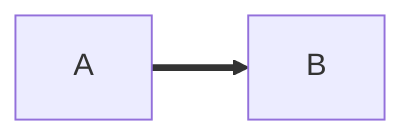

# Heading one

Intro with **bold**, *italic*, ~~strike~~, ==highlight== and `inline code`.
A [link](https://example.com), a wikilink [[Some Note]], an alias
[[Some Note|alias]], a heading link [[Some Note#Part]] and a block link
[[Some Note#^b1]]. Inline math $a^2 + b^2 = c^2$ sits in text. ^b0

$$
\int_0^1 x\,dx = \frac{1}{2}
$$

## Callouts

> [!note]
> A plain note with ==marked== text.

> [!question] Custom *title*
> Obsidian-only type.

> [!summary]- Folded
> Folded body.

> [!warning]
> Nested:
> > [!tip]
> > Inner tip.

## Lists

- one
- two
  - nested [[Link]]
1. first
2. second
- [ ] open task
- [x] closed task

## Table

| Name | Value |
|:-----|------:|
| 한글 | ==1== |
| [[Note]] | $x$ |

## Code

```rust
let s = "$$ [[ == ``` stays in code";
```



![[Embedded note]]

![[picture.png]]

%% a hidden comment %%

Footnote here[^n].

[^n]: The footnote text.

---

End.
